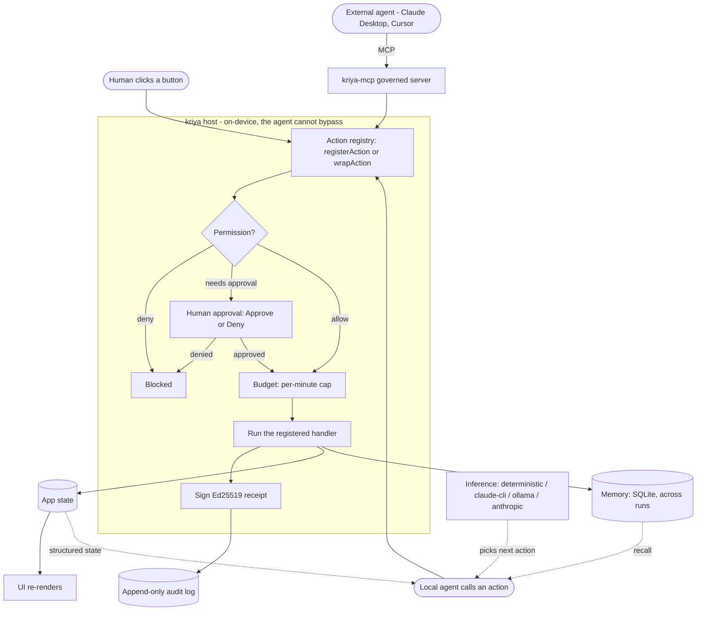

# kriya — govern everything your AI agents do, and prove it

[](LICENSE)
[](https://kriyanative.com/download/)
[](https://github.com/governex/kriya/releases/tag/audit-v0.1.0)
[](https://kriyanative.com/docs/)

> **Download one app.** It installs the governance gateway, walks you through the macOS permissions,
> wires your agents (Claude Code, Claude Desktop, Cursor, Hermes, …), and shows live, **signed proof
> of everything an agent does** — re-verified on your own machine. Every call is checked against
> deny-by-default policy, paused for human approval when it matters, and written to a tamper-evident,
> Ed25519-signed receipt — zero integration code. Receipts land in `~/.kriya/audit/` and the app
> tails them automatically.
>
> **You choose the boundary:** on one Mac, nothing leaves the machine — or scale the same guarantees
> to a whole fleet from your own on-prem server, up to fully air-gapped. Never a vendor cloud.

**Get it:**
[⬇ kriya Console for macOS](https://kriyanative.com/download/)
(free, signed + notarized, universal — v0.3.2) ·
[⬇ `kriya-audit` verifier](https://github.com/governex/kriya/releases/tag/audit-v0.1.0)
(free, macOS + Linux) ·
[Govern Claude Code in 5 minutes](https://kriyanative.com/docs/claude-code/) ·
[Govern Hermes](https://kriyanative.com/docs/hermes/)

**Don't trust us — check (60 seconds):**

```sh
curl -fsSLO https://github.com/governex/kriya/releases/download/audit-v0.1.0/kriya-audit-0.1.0-macos-universal.zip
unzip -o kriya-audit-0.1.0-macos-universal.zip
curl -fsSLO https://github.com/governex/kriya/releases/download/audit-v0.1.0/sample-receipts.jsonl
./kriya-audit sample-receipts.jsonl        # 20 signature(s) verified — OK
sed '1s/list_transactions/X/' sample-receipts.jsonl > tampered.jsonl
./kriya-audit tampered.jsonl               # FAIL — signature does not match (exit 1)
```

## Calling is solved. Governing isn't.

MCP already standardized how an agent *calls* software — stdio for local apps (how Claude Desktop and
Cursor spawn local servers), HTTP for cloud, WebMCP for the browser. That part is commodity and free.
What it deliberately leaves out is **enforcement**: human approval is a client-side *should*, and
stdio gets no auth at all.

So the missing piece isn't tooling — it's a **control plane**: a checkpoint between the agent and your
data that enforces **deny-by-default policy, human approval on the calls that matter, budgets, and a
signed, tamper-evident audit** — one the agent can't bypass and the client can't disable. It matters
most for the apps holding your most sensitive data: a local POS terminal, a finance tool, a healthcare
workstation. Those can't be governed from the *outside* — there's no cloud API to wrap, no external
door to enforce at. The control plane has to live where the data and the human are: **on the device.**

kriya is that control plane. Point any MCP agent at it and every call is checked, paused for approval
when it matters, and signed — on your machine, with nothing leaving it.

<p align="center">
  
  <br><em>An agent operating <a href="https://actualbudget.org">Actual Budget</a> through kriya: routine actions run and are signed; money-moving ones are blocked pending approval; every action verifies offline.</em>
</p>

## kriya-gateway — govern any MCP server, zero changes

**The fastest way in is the Kriya app** (macOS) — download it; it installs the gateway, requests the
macOS permissions it needs, and wires your MCP client (Claude Desktop, Cursor, Claude Code) for you,
then opens a live cockpit where you watch each governed call get approved and signed. No config files,
no manual paths — and because receipts land in `~/.kriya/audit/`, the app auto-discovers and tails
them the moment they appear.

If an app **already exposes an MCP server**, you don't have to bolt anything *into* it to govern it.
Every `tools/call` now passes deny-by-default policy → **human approval** for destructive calls →
budget → an Ed25519 **signed, hash-chained audit** — *before* it reaches the real server. **Zero
lines changed in that server.**

MCP over stdio is already easy and free — that's not the value. The value is the **approval modal
firing on a destructive call**, and the **signed, tamper-evident receipt** afterward, on a server
**you didn't write**.

**Power-user / manual path** — drive the same gateway from the command line instead:

```bash
# wrap any existing MCP server — your real server command goes after the `--`
kriya-gateway proxy -- node your-mcp-server.js
```

…or drop it straight into a client's MCP config (Claude Desktop, Cursor, Claude Code):

```jsonc
{
  "mcpServers": {
    "notes-governed": {
      "command": "kriya-gateway",
      "args": ["proxy", "--approval", "gui", "--", "node", "your-mcp-server.js"]
    }
  }
}
```

A runnable, no-human, end-to-end proof (a read goes through and is signed; a destructive call is
blocked at the gate and is not) lives in
[`examples/gateway-proxy-demo/`](examples/gateway-proxy-demo/) — `./run.sh`.

### What kriya governs

kriya governs agent actions through the surfaces where an agent already acts:
**hooks** (Claude Code via `kriya-hook`, Hermes via `kriya-hermes-hook` — every native tool and
every attached MCP server), the **MCP gateway/broker** (`kriya-gateway proxy` in front of any MCP
server, `kriya-gateway broker` multiplexing N upstreams under one governor), the **LLM proxy**
(`kriya-llm-proxy` in front of a local inference server), and the **governed egress/exec lanes**
(`kriya-gateway run` containment, `kriya-run-wasm` deterministic execution). Every governed action
gets a policy decision and an Ed25519-signed, hash-chained, offline-verifiable receipt — richness
tiered by instrumentation: semantic deny/approve of a **named** action at the top (bolt-on/serve),
tool-call gating through the proxy/hook seams elsewhere.

**Broker over HTTP (sidecar lane).** `kriya-gateway broker --config broker.yaml --listen
127.0.0.1:15090` serves the same governed broker as streamable-HTTP MCP at
`http://127.0.0.1:15090/mcp` instead of stdio (`--listen 127.0.0.1:0` picks a free port; the bound
address is printed on stderr). `POST /mcp` takes a JSON-RPC request or batch and always answers
`application/json` (notifications get `202`); `initialize` issues an `Mcp-Session-Id`, which is
never required afterwards; bodies are capped at 1 MiB; every response closes the connection. One
governor, one signed chain and one approval gate serve all callers, one request at a time. An
inbound `X-Kriya-Chain: a,b` header (validated, else ignored) is recorded as `"chain": ["a","b",
"<actor>"]` on every receipt for that request and forwarded to HTTP upstreams as
`X-Kriya-Chain: a,b,<actor>` — a cooperative, caller-asserted record of origin, not proof of it.
This version offers **no server-initiated stream**: `GET /mcp` is `405`, so server→client
notifications and requests are not delivered over HTTP. Without `--listen` the broker speaks stdio
exactly as before.

> **Honest scope.** A named-action policy needs an instrumented app; the proxy/hook seams govern
> tool calls, not what happens inside an app. The audit trail is tamper-**evident** (hash-chained,
> offline-verifiable), not tamper-proof.

> **Removed (2026-08-07):** the macOS desktop-reach lanes — **reach-in** (accessibility-tree tool
> synthesis) and **computer-use** (system-wide pixel control) — were removed to keep the library
> focused on govern/audit. They last shipped in crates.io `kriya 0.1.4` under non-default features;
> recover them from git history if you need them.

### Govern the whole Claude Code lane — `kriya-hook`

`kriya-hook` governs **everything Claude Code does through tools**: its native tools (`Bash`,
`Edit`, `Write`, …) *and* every MCP server attached to it (`mcp__<server>__<tool>` calls). Servers
added straight to Claude Code never pass a gateway — the hooks seam is the one place that sees them
all, with zero per-server config (the snippet sets no `matcher`, so it fires for every tool). The
gateway remains the seam for other MCP clients (Claude Desktop, Cursor, …):

```bash
cargo install kriya --bin kriya-hook --no-default-features
```

…then one paste into `~/.claude/settings.json`:

```jsonc
{
  "hooks": {
    "PreToolUse":  [{ "hooks": [{ "type": "command", "command": "kriya-hook pre" }] }],
    "PostToolUse": [{ "hooks": [{ "type": "command", "command": "kriya-hook post" }] }]
  }
}
```

`pre` is the **gate** (policy → optional human approval; a blocked call exits 2 with the reason, and
the blocked *attempt* is itself a signed receipt), `post` is the **record** (an Ed25519, hash-chained
receipt of what actually ran). MCP calls keep their full name — `mcp__github__create_issue` becomes
the governed action `claude-code__mcp__github__create_issue` — so **per-server policy is one prefix
glob** (`- { action: "claude-code__mcp__github__*", allow: true, require_approval: true }`).
Receipts land in `~/.kriya/audit/claude-code.jsonl` under a persistent
signing identity, the chain spans hook invocations, and the same offline verifiers — `kriya-audit`,
[`tools/verify-receipts`](tools/verify-receipts/), the 5-language bindings — re-prove them without
trusting this repo. The default policy is **record-only** (nothing blocks until you author rules);
budgets need the long-running gateway, and hooks are a cooperative seam — whoever controls
`settings.json` controls them (use managed settings org-wide). This works the same when Claude Code
runs against **your own AWS Bedrock** (`CLAUDE_CODE_USE_BEDROCK=1`): the model stays in your cloud
boundary, the action evidence stays on your machine.

**Action gates** — the policy file may carry a `gates:` section of ordered matcher rules
(`{class, rule_id, tier, command_any/all/not, path_any, tool_any}`) classifying the high-stakes
action shapes — deploys, destructive git, publishes, production-DB writes, infra mutation,
outbound sends, agent **self-modification** — into `allow | receipt | approve | deny`. The hook
evaluates them pre-execution as a **tighten-only** escalation over your action rules (a gate can
escalate an allowed action to approval/deny; it can never loosen a deny), reusing the same
approval gate and the same exit-2 blocking contract. Every decision is a signed
`kriya.gate.<class>.{evaluated,held,approved,denied}` receipt; on a block, the attempt's own
action receipt is recorded first and the gate receipt chain-links to it — the gate receipt itself
never carries command content. Absent `gates:` ⇒ behavior is byte-identical to earlier releases.
The [kriya Console](https://github.com/governex/kriya-console) authors and compiles this
section (per-class tiers, protected refs, prod matchers, packs); the format is plain YAML, so you
can also write it by hand — see `crates/kriya/tests/fixtures/default-gates.yaml` for the complete
default set and `tests/gate_vectors.rs` for the cross-implementation parity corpus.

**Payment governance** — `payment` is a first-class gate now (not a preview): a payment-shaped call
(a processor SDK/tool/host) is gated like any other class, and the hook also writes a **content-free
`kriya.pay.{intent,decision,outcome}` chain**. The three links join across the fresh pre/post hook
processes by a deterministic `pay_id` (session + tool + tool input) — **no marker file** — so a
denied payment closes all three synchronously, a held one is the honest 2/3 shape, and a proceeding
one gets its real `executed｜denied` outcome from the post hook. The amount is **best-effort and
honest** (integer minor-units + currency ⇒ `amount_known:true`, otherwise `false` — never a guessed
number); the merchant is the processor/host string only; **card material never enters a receipt**
(custody stays with credential brokering). Pure logic lives in `crates/kriya/src/pay.rs`
(unit-tested); the parity corpus is `tests/pay_fixture.rs` → `tests/fixtures/pay_ledger.jsonl`.

**Shift clamp** — for unattended windows, the hook reads an optional `~/.kriya/state/shift.json`
(armed · window · fail-tier, written by the Console) plus a bounded heartbeat tail: **armed + a
missed heartbeat inside the window ⇒ the action tier is clamped tighter** (approval → gate, deny →
exit 2), each decision a signed `kriya.shift.clamp` receipt. Tighten-only; state absent ⇒ no clamp;
a state-read failure never blocks. Pure clamp logic is `crates/kriya/src/shift_guard.rs`
(unit-tested), wired into the pre-decision path; the Console signs the matching
`kriya.attest.shift.{report,gap}` evidence on its own chain.

## Launch a governed run — `kriya-run`

`kriya-run` is the govern-first launcher: it composes a policy **pack + lanes + agent**, signs one
`kriya.run.launched` attestation, then execs the agent command — so a run's governance posture is on
the record from the first byte.

```bash
cargo install kriya --bin kriya-run
# start Claude Code under the Developer pack with the egress lane governed:
kriya-run --pack developer --lane egress --agent claude-code -- claude
```

The attestation params are **content-free** — `{v, agent, pack, lanes, shift}` only, never the
agent's argv or cwd. It is a **copy-first launcher, not a second enforcement path**: per-call
governance still flows through the agent's own hook/gateway lane (the honest ceiling). Pure
parse/compose logic is unit-tested; `tests/run_launched_fixture.rs` →
`tests/fixtures/run_launched_ledger.jsonl` is the signed parity corpus.

## Ask your own evidence — `kriya-mcp --evidence`

The evidence MCP server: a **stdio, zero-network, read-only** mode of `kriya-mcp` that lets any
MCP client — including the governed agent itself — query the local audit store: `receipts_search`,
`receipt_get`, `chain_verify`, `session_tree`, `spend_summary`.

```bash
cargo install kriya --bin kriya-mcp
kriya-mcp --evidence            # serves the standard ~/.kriya/audit dir over stdio
```

The honesty axiom, enforced in tests: every answer is computed **only from receipts that pass
verification** — a tampered line is counted `unverifiable` and excluded, never surfaced as data.
No write tools exist, and hashes stay hashes. The reader is itself in evidence: boot signs one
`kriya.evidence.mcp.start` receipt. (Wire it into Claude Code *through the governed lane* and the
evidence queries become receipted tool calls themselves.)

## Measured durations — honest per-action timing

Receipts can carry two **additive, optional** params: `kriya.dur.ms` + `kriya.dur.basis`. The hook
lane times a call across its fresh pre/post processes with an identity-keyed marker
(`duration.rs`; marker I/O is best-effort and **never blocks the gate**); the gateway and
llm-proxy lanes measure **in-process** (`basis: "in-process"`). No marker ⇒ no params — a missing
duration is shown by consumers as absent, never estimated. Old receipts verify byte-unchanged.

## Govern local inference — `kriya-llm-proxy` (F1)

Sovereign/air-gapped orgs run models **locally** — Ollama, llama.cpp's server, vLLM's OpenAI-compat
endpoint, LM Studio — and that traffic never touches an MCP client at all, so the gateway and hook
above never see it. `kriya-llm-proxy` is a governed reverse proxy for exactly that: point any
OpenAI-compatible or Ollama client at it instead of the model server's own port, and every completion
it forwards signs a receipt (model identity, the policy verdict, usage/performance) — the same
Ed25519, hash-chained signer path as everything else in this repo.

```bash
cargo install kriya --bin kriya-llm-proxy --no-default-features --features llm-proxy

# in front of a local Ollama server (its default port, 11434):
kriya-llm-proxy serve --listen 127.0.0.1:11435 --upstream http://localhost:11434
```

Point any client at the proxy's port instead of the model server's:

```bash
# OpenAI-compatible clients (OpenClaw, the openai SDK, LangChain, …):
export OPENAI_BASE_URL=http://127.0.0.1:11435/v1

# Ollama-native clients (Claude Code with a local-model backend, ollama-python, …):
export OLLAMA_HOST=http://127.0.0.1:11435
```

Every governed completion signs three receipts: `kriya.model.identity` (first sight of a model — name
+ resolved sha256 digest, read from the Ollama registry manifest or an operator-precomputed file-hash
cache, **never** by hashing a multi-GB weight file on the request path), `kriya.model.gate` (the
policy verdict — `warn` by default for an unrecognized model, real enforcement once you opt into
`require-approval`/`deny` in `agent-policy.yaml`'s `model:` section), and `kriya.model.serve` (usage:
`gen_ai.request.model`, input/output token counts, sampler params, prompt/output as sha256 hashes —
**never the text**). Streaming (SSE / Ollama's NDJSON) passes through live — the proxy hashes bytes as
they relay, it doesn't buffer a full response before forwarding.

Approve a known-good model's digest in the kriya Console's **Local Models** view, or precompute a
digest for a raw model file ahead of time (off the request path):

```bash
kriya-llm-proxy hash-model /path/to/your-model.gguf
```

> **Bypass honesty.** This proxy governs ONLY clients pointed at it. A process that connects straight
> to the upstream inference server's own port (e.g. `http://localhost:11434` directly) is invisible to
> it — no receipt, no gate. Closing that gap is a watcher-ladder item, not this one; never claim "all
> local inference" coverage from this proxy alone. **v1 scope:** observe + gate on model identity —
> deterministic re-execution and OMS/Sigstore manifest verification are later phases, not built here.

## Deterministic execution — `kriya-run-wasm` (F4)

"Here is the receipt" is good. "Re-run it yourself and get the same bytes" is better. This lane runs
a tool as a **WASI-p2 component** under a pinned Wasmtime (`=41.0.4`) configured so the result cannot
drift: fuel metering on, NaN canonicalization on, threads and relaxed-SIMD off, and **no ambient
clocks or randomness** — `wasi:clocks/*` and both `wasi:random/*` interfaces are virtualized
functions of a recorded seed and epoch.

```bash
cargo install kriya --bin kriya-run-wasm --no-default-features --features wasm-exec

kriya-run-wasm run ./text-transform.wasm -- --upper < input.txt   # → kriya-exec-bundle/1 + receipt
kriya-run-wasm --verify run-abc123.exec-bundle.json               # re-executes, hash-compares
```

Every run is captured as a `kriya-exec-bundle/1` (module sha256, exact Wasmtime version, a digest of
every deterministic knob, args/env/stdin as re-runnable bytes *and* hashes, fuel consumed,
stdout/stderr hashes) plus a signed `kriya.exec.deterministic` receipt binding the bundle's hash —
never raw content. The Console's free `kriya-audit --verify-exec` re-verifies the same bundle from an
**independently written** Rust implementation, so agreement means two codebases agree, not one.

Policy opts in per action via `exec.prefer_deterministic_lane` + `exec.wasm_variants`; an allowed
action with a registered WASM variant routes through the deterministic executor instead of its normal
one. Off by default, and BC-safe like every other optional policy dimension.

**Honest scope:** this is re-**execution**, and only for tools that ran *in this lane*. It is not a
general claim about shell-command determinism, and it is a different, narrower thing than the
Console's Verified Replay (which re-**derives** a timeline from signed receipts and re-runs nothing).
Two example governed tools live in [`examples/f4-wasm-tools/`](examples/f4-wasm-tools/).

## Why "kriya"?

**kriya** (Sanskrit, क्रिया) means *action* — and, in grammar, *verb*. That is the whole idea: an
agent shouldn't squint at your pixels, it should **act through your app's verbs**. The unit it
works through is the *kriya* — a single typed, governed action. We bind agents to **actions**, not
to screenshots. Same word, same bet: software you operate by *doing*, whether you're a human or a
machine.

## One app, two doors

```
Human  ──clicks a button──┐
                          ├──▶  the same typed action  ──▶  your handler ──▶ state ──▶ UI
Agent  ──calls an action──┘        (governed: permission · approval · budget · audit)
```

You declare each capability once — `registerAction(...)` for a new app, or `wrapAction(...)` to
adopt one you already have. The agent never simulates a human: it calls the typed action directly,
and it **can't** bypass the gates, because the *host* (not the agent) owns the policy and the
signing key.

## How it fits together

Every path in — a human click, your local agent, or an outside agent over MCP — lands on the same
registry and runs the same gauntlet before it ever touches your data:



The agent's *entire* view of your app is the right-hand side: **structured state** plus a typed
**menu of actions**. It never sees a pixel. The left-hand side — permission, approval, budget,
signing — is enforced in the host process, so a misbehaving or jailbroken agent still can't get
past it.

## What you get

- **Typed actions, not pixels.** Declare a capability once; humans click it, agents call it, both
  run the same handler. The agent reasons over structured state and a typed tool schema — fast and
  reliable, and it doesn't break when you restyle a button.
- **Governance, built in.** Every action an agent proposes runs this gauntlet on-device, before it
  executes:
  1. **Permission** — a deny-by-default policy: allow / require-approval / deny.
  2. **Human approval** — guarded actions pause for an Approve/Deny decision in *your* app's UI.
  3. **Budget** — a per-minute action cap *and* a per-hour inference-call cap stop a runaway or
     looping agent (the second bounds model cost, not just action bursts). The endpoint can also
     consult a **dollar** budget before the next action runs, so a breach denies it, routes it to a
     human, or warns — a trailing-state gate on settled spend, deliberately not a hard cap.
  4. **Signed audit** — an Ed25519 receipt per action → append-only log, verifiable offline.
     Optional build lanes swap the signer for a **FIPS 140-3 validated module** (AWS-LC-FIPS, CMVP
     cert #5298) or add a **post-quantum** ML-DSA-87 co-signature (CNSA 2.0-aligned); the two are
     mutually exclusive, and both are off by default.

  Plus persistent **memory** across runs, policy **linting**, and **step-through** debugging.
- **Speaks MCP.** Your actions become MCP tools; the governed `kriya-mcp` server lets any external
  agent drive your app — with every call routed *through* the gates, not around them.
- **Cross-shell, cross-language.** Runs in a Tauri backend, or as a standalone `kriya-host` sidecar
  that Electron, plain Node, **and Python** apps drive over stdio — governance in a process the
  renderer can't tamper with. One Rust host, a binding per language (TS + Python today; .NET/JVM
  next).

## Go deeper: instrument your own app

The download-the-app path above governs any MCP agent with zero integration code. When you own the
app and want the **deepest, enterprise tier** — semantic deny/approve of your app's *named* actions,
not just generic MCP calls — you instrument it directly. Two ways in:

**Build a new local-first agent app:**
```bash
npm create kriya-app@latest my-app    # Tauri 2 + React + Rust host, safety layer pre-wired
```

Then declaring a capability is one small block — the *same* handler your button already calls:

```ts
import { registerAction, str } from "kriya-core";

registerAction({
  id: "create_note",
  description: "Create a new note with a title and content.",
  parameters: { title: str, content: str },
  permissions: ["write:notes"],            // policy decides: allow / require approval / deny
  handler: ({ title, content }) =>          // ← your ordinary business logic, nothing special
    db.notes.insert({ title, content }),
});
```

That's the whole contract. A human clicks **New note**; an agent calls `create_note` — both run
the exact same `handler`, and the agent's call still passes permission → approval → budget → audit
on the way in. The agent discovers it automatically (kriya turns it into a typed tool schema), so
you write app logic, not agent plumbing. Adding the next capability is one more `registerAction`.

**Bolt onto an app you already have** — wrap a function it *already exposes*, no rewrite:
```ts
import { wrapAction } from "kriya-core";

wrapAction(actual.updateTransaction, {
  id: "categorize_transaction",
  description: "Assign a category to a transaction.",
  parameters: { id: str, category: str },
  mapParams: (p) => [p.id, { category: p.category }],
});

wrapAction(actual.deleteTransaction, {
  id: "delete_transaction",
  description: "Permanently delete a transaction.",
  parameters: { id: str },
  mapParams: (p) => [p.id],          // policy: require_approval — pauses for a human
});
```

That snippet is the demo above: [`examples/actual-budget-bolt-on/`](examples/actual-budget-bolt-on/)
gives a frontier agent governed access to [Actual Budget](https://actualbudget.org) — a real,
local-first finance app with **no HTTP API** — in ~37 lines, without changing Actual's code.
(`kriya wrap <file>` scaffolds the wrappers from your exported functions.)

> **Fewer lines — and far fewer tokens.** A published benchmark (Reflex, May 2026) ran vision-based
> and typed-action agents on the same task with Claude Sonnet: vision needed **551,000 input tokens
> across 53 steps** (~17 min); typed actions needed **12,000 tokens in 8 calls** (~20 sec) —
> **~45× more tokens and ~50× slower**. In kriya's own Actual Budget demo the ratio is similar:
> categorizing a transaction costs ~700 tokens via a typed action vs. ~8,000–15,000 tokens when
> screenshot-and-clicking the same edit. Typed actions are cheaper *because* the model reasons over
> meaning, not pixels.
> <br><sub>(Benchmark: Reflex, May 2026; kriya estimate via Anthropic's documented image-token formula.)</sub>

## What's in the box

| Package / crate | What |
|---|---|
| [`kriya-core`](packages/core/) | TypeScript SDK — `registerAction`, `wrapAction`, validation, MCP/JSON-Schema export, the `kriya` CLI (`dump`, `wrap`) |
| [`kriya-sidecar`](packages/sidecar/) | Node/TS binding — host the runtime from Electron or plain Node over stdio |
| [`kriya-inspector`](packages/inspector/) | Drop-in React dev inspector — step log, approval modal, memory replay |
| [`create-kriya-app`](packages/create-kriya-app/) | Scaffolder for a new local-first agent app |
| [`kriya`](crates/kriya/) | Rust agent host — step loop, swappable inference, permissions, budget, signed audit, memory, **governed MCP-server mode** |
| [`kriya` (Python)](bindings/python/) | **Python binding** — `register_action` / `wrap_action` + the `Host` stdio driver, for PyQt/PySide/Tk apps, FreeCAD/Blender plugins, data & quant tools (`pip install kriya`) |

**Binaries:** `kriya-gateway` (wrap any MCP server, zero changes) · `kriya-hook` (govern Claude
Code's whole tool lane — action gates, payment chain, shift clamp) · `kriya-hermes-hook` (Hermes'
native tools) · `kriya-run` (the **govern-first launcher** — compose a pack + lanes + agent, sign one
launch attestation, then exec) · `kriya-mcp` (governed MCP
server — external agents drive your app through the gates) · `kriya-govern` (per-call govern + sign
over stdio — the one signer the SDK middleware delegates to) · [`kriya-ci`](docs/GOVERNED-CI-LANE.md)
(the governed CI lane — run an agent step in CI under a repo policy; fail the build on a block; signed
receipts as a re-verifiable artifact) · `kriya-llm-proxy` (govern **local inference** — receipt every
completion from Ollama / llama.cpp / vLLM / LM Studio with its model digest, token usage, and
prompt/output hashes; gate on approved model identity) · `kriya-run-wasm` (the **deterministic
execution lane** — run a WASI-p2 tool under pinned Wasmtime with virtualized clocks and randomness,
then `--verify` re-runs it and hash-compares bit-for-bit) · `kriya-host` (the stdio sidecar) ·
[`tools/verify-receipts`](tools/verify-receipts/) (offline audit-log verifier).

**SDK middleware** (govern in-process agent-framework tool calls — no MCP hop, no crypto in the
wrapper): [`kriya-agents`](packages/agents/) (TypeScript) and [`kriya.agents`](bindings/python/)
(Python), with adapters for LangGraph, the OpenAI Agents SDK, CrewAI, and the Claude Agent SDK.

**Reference apps:** [`apps/note-app`](apps/note-app/) and [`apps/task-manager`](apps/task-manager/)
— two domains on the one shared host crate.

## Quick start

Try the governed bolt-on with zero setup (in-memory budget, no real data):

```bash
cd examples/actual-budget-bolt-on && ./demo.sh   # builds everything on first run, then plays it
```

Or run the reference desktop app:

```bash
npm install
npm run build --workspace kriya-core
npm run tauri dev --workspace note-app   # first run compiles the Rust backend (a few min)
```

Pick the inference backend with `AGENT_BACKEND` (`deterministic` default, or `claude-cli` /
`ollama` / `anthropic`).

## Docs

- [architecture.md](architecture.md) — how the pattern works, end to end
- [docs/SECURITY.md](docs/SECURITY.md) — how the signed audit trail is tamper-evident (and an honest threat model)
- [docs/ROADMAP.md](docs/ROADMAP.md) — what's built and what's next
- [docs/PRODUCT_GAPS.md](docs/PRODUCT_GAPS.md) — honest feature-completion tracker
- [docs/CONTINUE.md](docs/CONTINUE.md) — copy-paste prompt to advance the roadmap by one item

## Why this matters now

- **EU AI Act** high-risk (Annex III) obligations were **deferred to December 2, 2027** by the
  Digital Omnibus (agreed May 2026; Annex I embedded systems → Aug 2028) — but the requirement is
  unchanged: agents touching regulated data need auditable, governed interfaces, with non-compliance
  fines up to **€15M / 3%** of worldwide turnover (the 7% / €35M tier is for *prohibited* practices).
- **Gartner** projects 40% of enterprise apps will embed AI agents by end of 2026 — and 40% of
  enterprises will demote or decommission autonomous agents by 2027 due to governance gaps.
- The **NSA AI Security Center** (May 2026) warned that MCP's rapid adoption has outpaced its
  security model; a **CoSAI** whitepaper identified nearly 40 MCP-specific threats across 12
  categories.
- For desktop/local apps, the only GA product is Microsoft Copilot Studio — still vision-based,
  still ungoverned. That's the gap kriya fills.

## One app, two tiers

It's a single download with two tiers — no SaaS, no accounts, no cloud; **everything runs
on-device.**

- **Free** — the live governance monitor, offline receipt verification, and guided setup. Fully
  usable on its own: download free and you're watching each governed call get approved and signed,
  and you can verify any receipt without trusting the vendor.
- **Compliance tier** *(license-gated)* — unlocks **auditor-ready evidence export** and **cross-app
  correlation**: one trustworthy view of what every agent did across all your governed apps,
  exported as evidence for an auditor. Tampered or forged entries are flagged. The license is an
  offline license — no SaaS, no accounts, no cloud.

The paid tier never changes how governance works — it consumes the same Ed25519-signed receipts and
the same policy the free monitor already verifies and enforces. Tamper-evident audit plus
correlated, exportable evidence is what **CMMC Level 2**, **SOC 2**, and **EU AI Act**
record-keeping ask for when an agent touches real data — on-device, where cloud MCP gateways
structurally can't reach.

**Going fleet-wide:** [kriyaD](https://kriyanative.com/products/kriyad/) — the customer-hosted
control-plane server + fleet cockpit (air-gap, on-prem, or your VPC; never a vendor cloud) — ships
today for design partners: fleet inventory + liveness, central policy authoring with an
org-key-signed downlink devices verify before applying (anti-rollback included), policy drift
re-verified locally from each device's own signed envelopes, and one org-wide, assessor-ready
evidence export.

<p align="center">
  
  <br><em>The fleet cockpit: policy drift re-verified locally from each device's own signed envelopes — the server's word is only a hint.</em>
</p>

Enterprise & regulated deployments → [kriyanative.com](https://kriyanative.com) ·
Sandeepshekhar26@gmail.com.

## Status

Alpha. The pattern, the cross-shell runtime, and the full safety layer work end-to-end — typed
actions, governed MCP-server mode, the gateway proxy, the Claude Code + Hermes hooks, the
Electron/Node sidecar, the `wrapAction` bolt-on, and the Actual Budget flagship are all shipped, and
the notarized Console (v0.2.3) ships on top of them. APIs may still change before a stable release.
MIT licensed.
